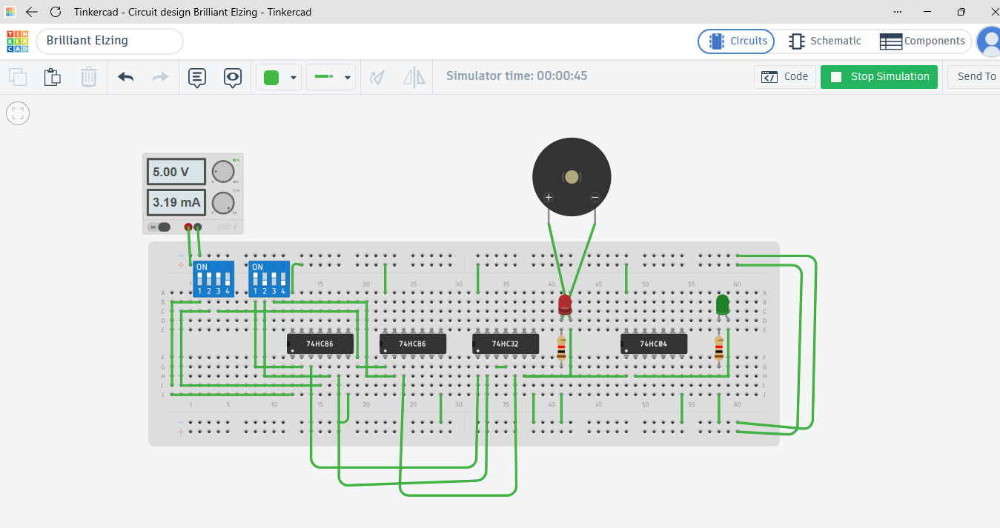

# DLD Biometric Security Vault

## Project Overview
The DLD Biometric Security Vault is a Digital Logic Design project created using Tinkercad Circuits. It demonstrates the use of digital logic gates, switches, and output indicators to implement a basic access-control system.

## Objectives
- To understand the practical application of digital logic gates.
- To process inputs using DIP switches.
- To demonstrate access-control logic through output indicators.
- To use LEDs and a buzzer to indicate circuit outputs.

## Components Used
- DIP switches
- Digital logic gates
- LEDs
- Buzzer
- Resistors

## Working Principle
The circuit processes input combinations from the DIP switches using digital logic. The output depends on the logic conditions designed in the circuit. LEDs indicate the output status, while the buzzer provides an alert when triggered by the circuit.

## Tools Used
- Tinkercad Circuits
- Digital Logic Design (DLD)

## Circuit Diagram

## Project Files
- `Circuit.png` — Circuit image.
- `Circuit1.lpng` — Additional uploaded project file.

## Tinkercad Project Link
[View the project on Tinkercad](https://www.tinkercad.com/things/0alpClEf3Qr-brilliant-elzing/editel?returnTo=https%3A%2F%2Fwww.tinkercad.com%2Fdashboard&sharecode=uTZyFMGsQiW-wF9Bt7XDaIGmjC2zsHubhsxOD-5QDmE)

## Author
Ragini Sawlani
